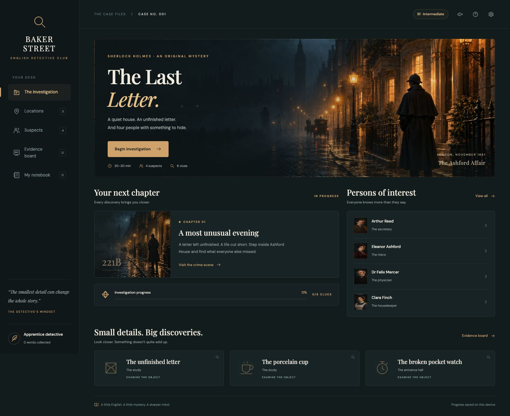
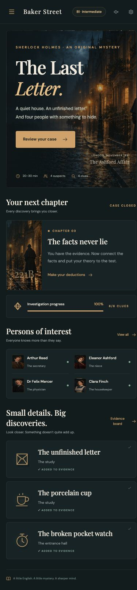

# Baker Street: английский через детективное расследование

Создал игровой веб-прототип, в котором английский нужен для решения конкретной задачи: разобраться в показаниях, найти противоречия и обосновать обвинение. В первом эпизоде есть завершённое расследование, четыре подозреваемых и две развязки. Игрок читает материалы дела на английском, при необходимости открывает перевод и собирает собственную версию событий.

[Исходный код на GitHub](https://github.com/reinekes/english_detectives) · [Играть на GitHub Pages](https://reinekes.github.io/english_detectives/)

## От идеи к задаче

Отправной точкой стала идея практики английского через интерес к истории. В обычном упражнении текст часто нужен, чтобы ответить на учебный вопрос. Здесь смысл прочитанного влияет на расследование: можно сопоставить свидетельства, заметить несоответствие и открыть следующий вывод.

Для первого прототипа выбрал взрослого русскоязычного игрока с английским примерно B1. Это авторский ориентир сложности текста, а не результат языковой сертификации. Вместо большой библиотеки эпизодов сосредоточился на одном деле, которое можно пройти от завязки до объяснения результата.

Мир викторианского Лондона задал атмосферу. **The Ashford Affair — The Last Letter** — оригинальная детективная история, вдохновлённая миром Шерлока Холмса. Она не пересказывает конкретный рассказ и использует вымышленных персонажей.

## Собрать понятный игровой маршрут

Основной цикл построил вокруг нескольких действий: прочитать зацепку, выбрать место или собеседника, получить факт и проверить гипотезу. Для навигации выделил пять разделов: дело, локации, подозреваемые, доска доказательств и блокнот. Текущая цель помогает продолжить расследование, не раскрывая ответ.

Игрок исследует три локации и собирает шесть улик. У каждого из четырёх подозреваемых есть три подготовленных вопроса — всего двенадцать ответов. Найденные материалы можно перечитывать; повторный осмотр не создаёт новые экземпляры той же улики.

На доске доступны три задания на дедукцию. Они открываются по условиям и требуют выбрать содержательный вывод из вариантов. Ошибка даёт обратную связь и позволяет попробовать снова. Для финала нужно решить обязательные задания, выбрать подозреваемого и три доказательства. Ошибочное обвинение сохраняет собранные материалы и позволяет вернуться к делу.

## Сделать развязку следствием фактов

Сюжет потребовал отдельной работы с логикой. Для каждого вывода связал вопрос, необходимые сведения и объяснение результата. Ключевые факты доступны до финального обвинения: развязка не должна зависеть от нового обстоятельства, которое игрок впервые увидит в последнем экране.

Показания персонажей, наблюдения и выводы выполняют разные роли. Свидетельство может потребовать проверки; само появление текста ещё не делает его доказанным фактом. Финальное решение принимает игрок, а программа проверяет выбранную версию по правилам дела.

Логическую схему с разгадкой вынес в отдельный документ для разработки. В этом кейсе оставил только устройство расследования, чтобы знакомство с проектом не мешало самостоятельному прохождению.

## Визуальный язык и мобильный экран

Для оформления выбрал тёмный бирюзовый фон, медные акценты, янтарный свет и кремовые поверхности карточек. Общая сцена передаёт дождливый вечер в Лондоне, а портреты помогают различать собеседников. Иллюстрации созданы через генерацию изображений; происхождение и промпты сохранены в документации проекта. Это художественная стилизация, без претензии на точную реконструкцию города.

*Настольный экран, 1440 px. Атмосферная иллюстрация, вводная часть дела и навигация образуют единый интерфейс расследования.*

На телефоне разделы доступны через мобильное меню. Длинные диалоги прокручиваются, а после закрытия окна фокус возвращается к исходному действию. Отдельно исправил вложенный словарь: сохранение слова должно возвращать читателя к той улике или реплике, которую он изучал.

*Экран шириной 390 px. Содержание перестраивается под телефон; основные действия доступны без горизонтальной прокрутки страницы.*

## Встроить поддержку чтения в расследование

Английский текст сопровождается русским переводом по запросу. Подготовил шестнадцать словарных карточек с переводом, произношением и контекстом. Слова можно сохранить в блокнот и удалить, когда они больше не нужны. При проверке убрал учебные примеры, которые могли раньше времени выдать важные детали дела.

Для прослушивания используется синтез речи браузера. Доступность и звучание английского голоса зависят от устройства. Необязательный шум дождя поддерживает атмосферу; содержание игры доступно и без звука.

Блокнот хранит личную теорию игрока. Журнал фиксирует значимые действия с номером и временем, а экспорт сохраняет ход расследования и заметки в Markdown. Так после сессии остаётся читаемый документ. Влияние этой механики на запоминание слов или уровень английского в проекте не измерялось.

## Архитектура под объём одного эпизода

Прототип работает на HTML, CSS и обычном JavaScript. Статические файлы находятся в `dist/` репозитория (локально — `baker-street/dist/`); обязательной сборки и сервера приложений нет. Для локального запуска достаточно HTTP-сервера.

Содержание дела отделил от правил и интерфейса. `case-data.js` хранит персонажей, тексты, улики и словарь; `engine.js` управляет состоянием, условиями переходов и сохранениями; `app.js` связывает их с экраном, диалогами, звуком и экспортом. Благодаря этому правила расследования можно проверять без браузерной отрисовки.

Прогресс, заданные вопросы, выводы, слова, заметки и настройки сохраняются в `localStorage`. При загрузке проверяются структура и допустимые идентификаторы. Повреждённые данные не должны превращать запуск в пустой экран. Перезапуск требует подтверждения и удаляет только сохранение этого приложения.

## Проверить прохождение и пограничные случаи

В проекте проходят **16 автоматических тестов**. Они проверяют данные реального дела, достижимость развязки, блокировку раннего финала, повторные действия, ошибочные решения, повреждённые сохранения, словарь и экспорт. Это проверки конкретных правил прототипа; они не заменяют просмотр интерфейса.

В локальном браузере пройдены обе развязки, собраны все шесть улик и открыты все двенадцать ответов. Проверены неверная дедукция, возврат после ошибочного обвинения, перевод, сохранение и удаление слова, заметки и восстановление состояния после перезагрузки. Экспортированный Markdown действительно скачан и прочитан с диска.

Интерфейс проверен на ширинах **360, 390 и 1440 px**. На узких экранах открываются все разделы, работает меню, у страницы нет горизонтального переполнения. Дополнительно проверены открытие вступления клавиатурой, закрытие диалога через Escape и возврат фокуса. Эти проверки описывают проверенные сценарии, без заявления о полном аудите доступности.

## Результат и границы прототипа

Получилось законченное браузерное расследование одного эпизода: от первого знакомства с делом до вердикта и его объяснения. В одном маршруте связаны чтение, поиск сведений, дедукция и собственные заметки. К исходникам приложены техническое задание, план реализации, логика сюжета и журнал выполненных проверок. Проект опубликован на GitHub Pages: workflow проверяет JavaScript и тесты, затем размещает только игровую папку `dist/`. Публичный адрес открыт в браузере; проверены начало расследования, переход к локациям и осмотр улики без авторизации.

Текущая версия использует подготовленные диалоги и фиксированную разгадку. В ней нет аккаунтов, облачной синхронизации, интервальных повторений и свободного AI-разговора. Сохранение привязано к браузеру и адресу сайта; Markdown-журнал служит читаемым экспортом, но не импортируемой резервной копией. Сценарий находится в клиентском коде, поэтому исходники содержат спойлеры.

## Что развивать дальше

Следующий шаг — проверить первое дело с игроками: где теряется нить расследования, насколько понятны условия выводов и когда требуется перевод. После этого можно расширять библиотеку эпизодов и добавлять упражнения по сохранённым словам.

Для новых дел потребуется общая схема контента и проверка связей между уликами, вопросами и финалом. Облачные профили и синхронизация относятся к отдельному этапу. AI-персонажей стоит вводить только с правилами, которые удерживают ответы в пределах авторского сюжета и не позволяют выдумывать обязательные доказательства. Эти возможности обозначены как развитие проекта и не входят в реализованный прототип.
